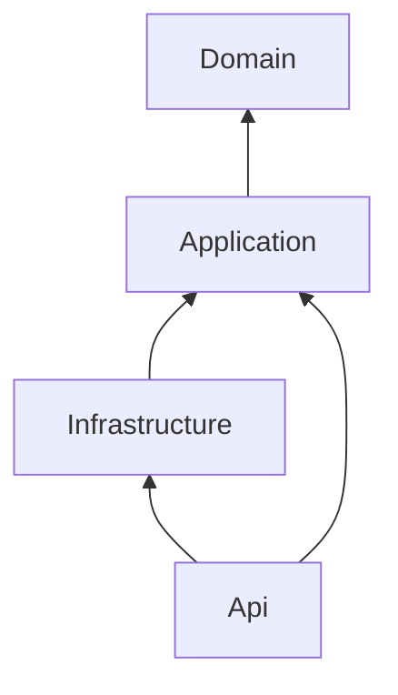
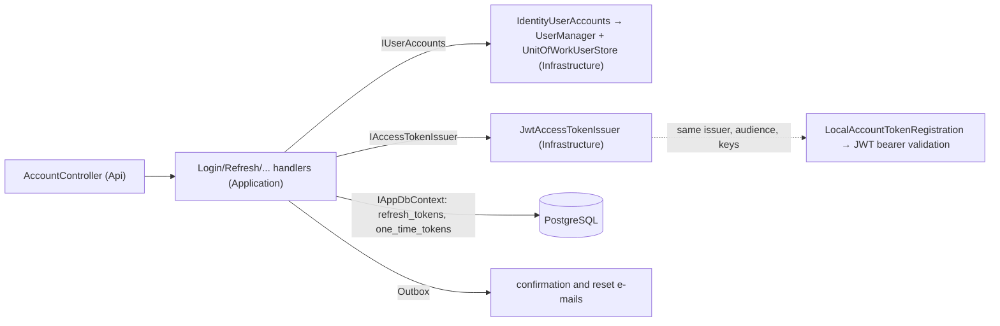
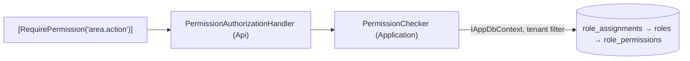
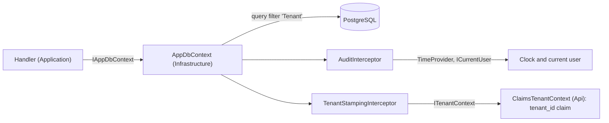
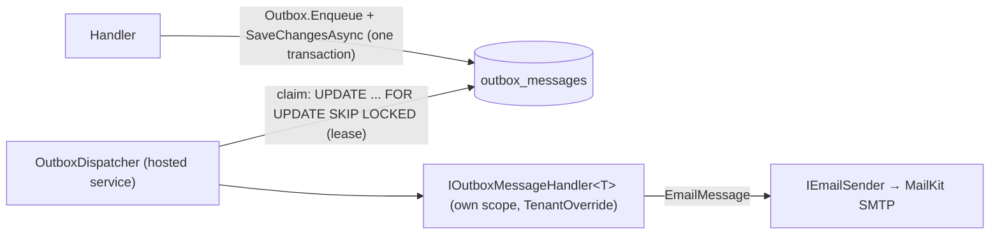

# Architecture

A modular monolith with four source projects and vertical feature slices. The dependency
rules below are enforced by `tests/Boilerplate.ArchitectureTests`; the reasoning is in
[ADR-0001](adr/0001-architecture-style.md).

## Projects

| Project | Owns | Must not contain |
|---|---|---|
| `Boilerplate.Domain` | Entities with behaviour (factory methods, private setters, invariants), domain enums, domain exceptions | EF Core, ASP.NET Core, logging, serialization attributes, template names, HTTP error vocabulary |
| `Boilerplate.Application` | Use cases in `Features/<Area>/<UseCase>/` (request, handler, validator, response), ports (interfaces for external boundaries), application exceptions, settings classes | ASP.NET Core types (`HttpContext`, `IFormFile`), vendor SDKs, the `DbContext` implementation |
| `Boilerplate.Infrastructure` | EF Core `DbContext`, configurations, migrations, implementations of Application ports (email, tokens, storage, ...) | Business rules: anything that decides *what* happens belongs in Application |
| `Boilerplate.Api` | `Program.cs` (composition root), endpoints, HTTP middleware and filters, ProblemDetails mapping, OpenAPI | Business logic; direct use of Infrastructure outside `Program.cs` and `Boilerplate.Api.Registration` |

## Allowed dependencies



1. `Domain` references no project and no package.
2. `Application` references only `Domain`, plus allowlisted packages (see `PackagePolicyTests`).
3. `Infrastructure` references only `Application`. Domain types reach it transitively; do not add a direct reference.
4. `Api` references `Application` and `Infrastructure`. Infrastructure types may be used only in `Program.cs`
   and the `Boilerplate.Api.Registration` namespace (the composition root).
5. Nothing references `Api` except tests.
6. Domain and Application never use `Microsoft.AspNetCore.*`; Domain never uses EF Core.

## How the rules are enforced

- `ProjectReferenceTests`: declared `<ProjectReference>` items match the graph above exactly, and every
  source project has a rule.
- `PackagePolicyTests`: Domain has no packages, Application packages are allowlisted, banned packages are absent.
- `LayerDependencyTests`: compiled types do not use forbidden namespaces (read from assembly metadata with NetArchTest).

Declared references and compiled usage are checked separately because the compiler drops a reference
that no code uses yet. A forbidden reference must fail the build before anyone writes code against it.

## Request flow (target, built up from M1 onwards)

```
HTTP -> forwarded headers -> security headers -> exception handler -> CORS -> authentication -> rate limit
     -> authorization -> endpoint
     -> validation filter -> handler (Application) -> ports / IAppDbContext -> one commit point
     -> response
Failures -> typed exceptions -> ProblemDetails (RFC 9457) with traceId
```

### Current pipeline, in `src/Boilerplate.Api/Program.cs`

| Order | Component | Why here |
|---|---|---|
| 1 | `UseForwardedHeaders` | First, so everything after it sees the real client IP and scheme, taken only from trusted proxies (ADR-0024) |
| 2 | `UseSerilogRequestLogging` | Outermost logging, so the summary records the final status code; health probes at Debug (ADR-0024) |
| 3 | `UseSecurityHeaders` | Adds headers just before the response starts, so error responses get them too (ADR-0024) |
| 4 | `UseExceptionHandler` + `ApiExceptionHandler` | Catches exceptions from everything after it and writes ProblemDetails (ADR-0006) |
| 5 | `UseHsts` (not in Development) | HSTS on HTTPS requests (ADR-0024) |
| 6 | `UseStatusCodePages` | Gives body-less error responses (unknown routes, 401/403/429) a ProblemDetails body |
| 7 | `UseCors` | Before authentication, so browser preflight requests need no token (ADR-0024) |
| 8 | `UseAuthentication` | Validates the JWT bearer token and sets the user (ADR-0016) |
| 9 | `UseRateLimiter` | After authentication (budget per user, else per IP), before authorization (ADR-0024) |
| 10 | `UseAuthorization` | Applies endpoint policies; the fallback policy requires an authenticated user with `sub` everywhere else, including paths without an endpoint |
| 11 | OpenAPI + Scalar (Development only, anonymous) | Documentation endpoints (ADR-0013) |
| 12 | `/health/live` (anonymous) | Liveness probe; runs no dependency checks |
| 13 | `/health/ready` (anonymous) | Readiness probe: database reachable and no pending migrations, each check limited to 5 seconds (ADR-0024) |
| 14 | Controllers (`/api/v1/...`) | Feature endpoints (ADR-0020); `ValidationFilter` validates action arguments first (ADR-0014) |

OpenTelemetry traces every request except health probes, plus outgoing HTTP calls and PostgreSQL commands (ADR-0023).
Kestrel rejects request bodies over 1 MB with 413 ProblemDetails.

## A feature, end to end (projects)

```
POST /api/v1/projects
  → [RequirePermission("projects.manage")]      403 without it (ADR-0017)
  → ValidationFilter + CreateProjectValidator     400 with errors per field (ADR-0014)
  → ProjectsController.Create                     binds, calls one handler
  → CreateProjectHandler (Application)            entity rules (DomainException → 400), uniqueness (ConflictException → 409)
  → IAppDbContext.SaveChangesAsync               tenant stamping, audit, unique violation → 409 (ADR-0010/0011)
  → 201 Created + ProjectResponse                 hand-written mapping (ADR-0015)
```

The step-by-step guide is [how-to-add-a-feature.md](how-to-add-a-feature.md).

The service provider validates registrations at startup (`ValidateOnBuild`, `ValidateScopes`), and a failed
startup is logged and exits with code 1 (ADR-0007). Startup also fails without valid token settings (ADR-0016).

## Identity

| Piece | Project | Responsibility |
|---|---|---|
| `ICurrentUser` | Application | The caller's user id (`sub`), or none |
| `ClaimsCurrentUser`, `ClaimsTenantContext` | Api | Read `sub` and `tenant_id` from the validated token |
| `AuthenticationRegistration`, `JwtBearerSettingsValidation` | Api | JWT bearer setup, deny-by-default policy, startup validation of token settings |
| `MeController` | Api | `GET /api/v1/me`: the identity the API resolved from the caller's token |

### Local accounts (optional, ADR-0025)



| Piece | Project | Responsibility |
|---|---|---|
| `RefreshToken`, `OneTimeToken` | Domain | Rotation and reuse rules; single-use e-mailed tokens. Only hashes are stored |
| `Features/Accounts`, `AccountSessions`, `OneTimeTokens` | Application | Use cases, token pairs and family revocation, issuing and redeeming e-mailed tokens |
| `IUserAccounts`, `IAccessTokenIssuer`, `AccountSettings` | Application | Ports and settings |
| `ApplicationUser`, `IdentityUserAccounts`, `UnitOfWorkUserStore` | Infrastructure | Identity Core users, password hashing, lockout; the store never saves on its own |
| `JwtAccessTokenIssuer`, `AccessTokenOptions` | Infrastructure | HMAC-SHA256 access tokens, current and previous signing keys |
| `AccountController`, `RequireAccountsEnabledAttribute`, `LocalAccountTokenRegistration` | Api | Endpoints (404 unless enabled), per-IP rate limit, local tokens accepted by the bearer scheme |

## Authorization



| Piece | Project | Responsibility |
|---|---|---|
| `Role`, `PermissionGrant`, `RoleAssignment`, `PermissionName` | Domain | Tenant-owned roles and their permissions; user-to-role assignments; the canonical permission format |
| `PermissionChecker` | Application | One indexed query per check, scoped to the current user and tenant; no cache (ADR-0017) |
| `RequirePermissionAttribute`, `PermissionRequirement`, `PermissionAuthorizationHandler` | Api | Declaring and evaluating permission requirements on endpoints |

Anonymous → 401; authenticated without the permission or without a tenant → 403.

### Role administration (ADR-0022)

| Piece | Project | Responsibility |
|---|---|---|
| `Role.IsAdministrator` | Domain | The built-in role that implicitly grants every permission; cannot be changed or deleted |
| `PermissionCatalog` | Application | Every known permission; roles may only contain these |
| `RoleEscalationGuard` | Application | Callers grant, remove or hand out only permissions they hold (403 otherwise) |
| `Features/Roles`, `RolesController`, `PermissionsController` | Application, Api | Role CRUD, assignments, catalogue |
| `BootstrapTenantHandler`, `BootstrapCommand` | Application, Api | `bootstrap` command: tenant + administrator role + first administrator, one transaction |
| `TenantOverride` | Application | Explicit tenant for commands, background work and platform administration; `ClaimsTenantContext` prefers it over the claim |

### Platform administration and invitations (ADR-0027)

| Piece | Project | Responsibility |
|---|---|---|
| `PlatformAdministrator` | Domain | A token subject allowed to administer tenants; not tenant-owned, no access inside tenants |
| `PlatformAdministratorChecker`, `RequirePlatformAdministratorAttribute`, `PlatformAdministratorAuthorizationHandler` | Application, Api | One indexed query per request, no cache; 403 without the grant |
| `PlatformAdministratorGrants`, `PlatformAdministratorCommand` | Application, Api | `platform-admin grant\|revoke --user <subject>`; the only way to grant it |
| `Features/Tenants`, `PlatformTenantsController` | Application, Api | List, create (administrator role + invitation, one transaction), rename tenants; invite administrators |
| `Invitation` | Domain | Tenant-owned offer of a role; hashed single-use token, expiry, revocation |
| `InvitationSender`, `Features/Invitations`, `InvitationsController` | Application, Api | Issue (escalation guard, outbox e-mail), list, revoke, accept (reviewed tenant-filter bypass by token hash) |

## Persistence and tenancy



| Piece | Project | Responsibility |
|---|---|---|
| `Entity`, `IAuditable`, `ITenantOwned`, `Tenant` | Domain | Identity (GUID v7), audit and tenancy markers, the tenant entity |
| `IAppDbContext`, `ITenantContext` | Application | Ports used by handlers and by persistence |
| `AppDbContext` | Infrastructure | Model, configurations, and automatic tenancy rules for every `ITenantOwned` entity |
| `AuditInterceptor`, `TenantStampingInterceptor` | Infrastructure | Who and when on save (`ICurrentUser`, `TimeProvider`); tenant stamping and cross-tenant write rejection |
| `DependencyInjection.AddInfrastructure` | Infrastructure | Options, provider, interceptors, health check; `ConfigureDbContext` is the single wiring point |
| `ClaimsTenantContext` | Api | Current tenant from the `tenant_id` claim (none until authentication, M5) |

Without a current tenant, tenant-owned reads return no rows and writes throw (fail closed). Details and known
gaps (raw SQL, caches, background jobs) are in [ADR-0010](adr/0010-tenancy-model.md).

## Outbox and e-mail (ADR-0019)



| Piece | Project | Responsibility |
|---|---|---|
| `Outbox`, `OutboxMessage`, `IOutboxMessageHandler<T>`, `AddOutboxMessage` | Application | Enqueue in the use case's unit of work; register message types and handlers |
| `EmailMessage`, `IEmailSender`, `SendEmailHandler` | Application | The built-in e-mail message and its port |
| `OutboxProcessor`, `OutboxDispatcher`, `OutboxOptions` | Infrastructure | Claim with a lease, handle per tenant, retry with backoff, dead-letter, clear delivered payloads |
| `MailKitEmailSender`, `SmtpOptions` | Infrastructure | SMTP delivery; the outbox id becomes the `Message-ID` |

No database transaction is held while a handler calls an external service; delivery is at least once.

## Housekeeping (ADR-0026)

`HousekeepingService` (hosted service, Infrastructure) runs `HousekeepingCleaner` at startup and then on a timer.
Each round deletes, in bounded batches, refresh and one-time tokens that expired more than the retention ago and
outbox messages delivered more than the retention ago. Pending and dead-lettered messages are never deleted.
Deleting is idempotent, so every instance may run it without coordination; `Housekeeping:Enabled` turns it off.
