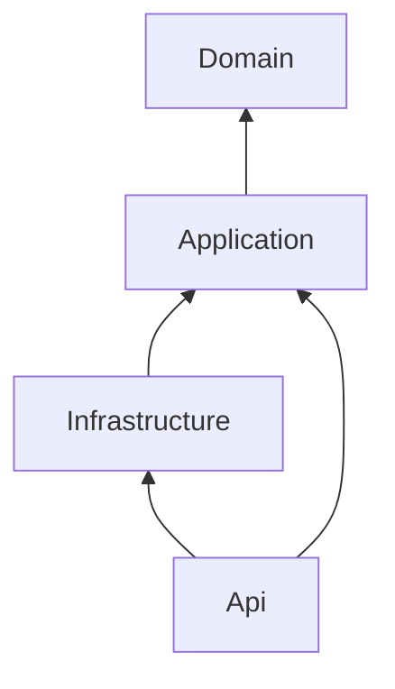
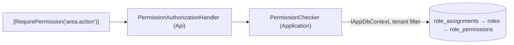
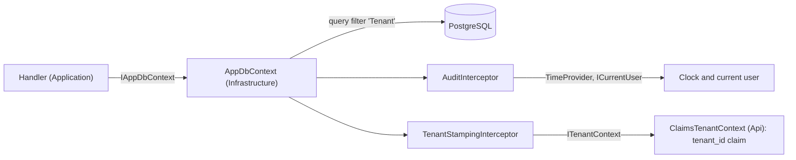

# Architecture

A modular monolith with four source projects and vertical feature slices. The dependency
rules below are enforced by `tests/Boilerplate.ArchitectureTests`; the reasoning is in
[ADR-0001](adr/0001-architecture-style.md).

## Projects

| Project | Owns | Must not contain |
|---|---|---|
| `Boilerplate.Domain` | Entities with behaviour (factory methods, private setters, invariants), domain enums, domain exceptions | EF Core, ASP.NET Core, logging, serialization attributes, template names, HTTP error vocabulary |
| `Boilerplate.Application` | Use cases in `Features/<Area>/<UseCase>/` (request, handler, validator, response), ports (interfaces for external boundaries), application exceptions, settings classes | ASP.NET Core types (`HttpContext`, `IFormFile`), vendor SDKs, the `DbContext` implementation |
| `Boilerplate.Infrastructure` | EF Core `DbContext`, configurations, migrations, implementations of Application ports (email, tokens, storage, ...) | Business rules: anything that decides *what* happens belongs in Application |
| `Boilerplate.Api` | `Program.cs` (composition root), endpoints, HTTP middleware and filters, ProblemDetails mapping, OpenAPI | Business logic; direct use of Infrastructure outside `Program.cs` and `Boilerplate.Api.Registration` |

## Allowed dependencies



1. `Domain` references no project and no package.
2. `Application` references only `Domain`, plus allowlisted packages (see `PackagePolicyTests`).
3. `Infrastructure` references only `Application`. Domain types reach it transitively; do not add a direct reference.
4. `Api` references `Application` and `Infrastructure`. Infrastructure types may be used only in `Program.cs`
   and the `Boilerplate.Api.Registration` namespace (the composition root).
5. Nothing references `Api` except tests.
6. Domain and Application never use `Microsoft.AspNetCore.*`; Domain never uses EF Core.

## How the rules are enforced

- `ProjectReferenceTests`: declared `<ProjectReference>` items match the graph above exactly, and every
  source project has a rule.
- `PackagePolicyTests`: Domain has no packages, Application packages are allowlisted, banned packages are absent.
- `LayerDependencyTests`: compiled types do not use forbidden namespaces (read from assembly metadata with NetArchTest).

Declared references and compiled usage are checked separately because the compiler drops a reference
that no code uses yet. A forbidden reference must fail the build before anyone writes code against it.

## Request flow (target, built up from M1 onwards)

```
HTTP -> exception handler -> authentication -> authorization -> endpoint
     -> validation filter -> handler (Application) -> ports / IAppDbContext -> one commit point
     -> response
Failures -> typed exceptions -> ProblemDetails (RFC 9457) with traceId
```

### Current pipeline, in `src/Boilerplate.Api/Program.cs`

| Order | Component | Why here |
|---|---|---|
| 1 | `UseSerilogRequestLogging` | Outermost, so the request summary records the final status code, including handled errors |
| 2 | `UseExceptionHandler` + `ApiExceptionHandler` | Catches exceptions from everything after it and writes ProblemDetails (ADR-0006) |
| 3 | `UseStatusCodePages` | Gives body-less error responses (unknown routes, 401/403 challenges) a ProblemDetails body |
| 4 | `UseAuthentication` | Validates the JWT bearer token and sets the user (ADR-0016) |
| 5 | `UseAuthorization` | Applies endpoint policies; the fallback policy requires an authenticated user with `sub` everywhere else, including paths without an endpoint |
| 6 | OpenAPI + Scalar (Development only, anonymous) | Documentation endpoints (ADR-0013) |
| 7 | `/health/live` (anonymous) | Liveness probe; runs no dependency checks |
| 8 | `/health/ready` (anonymous) | Readiness probe; checks the database (health checks tagged `ready`) with a 5-second timeout, because connection retries would otherwise delay the answer by about a minute |
| 9 | Controllers (`/api/v1/...`) | Feature endpoints (ADR-0020) |

The service provider validates registrations at startup (`ValidateOnBuild`, `ValidateScopes`), and a failed
startup is logged and exits with code 1 (ADR-0007). Startup also fails without valid token settings (ADR-0016).

## Identity

| Piece | Project | Responsibility |
|---|---|---|
| `ICurrentUser` | Application | The caller's user id (`sub`), or none |
| `ClaimsCurrentUser`, `ClaimsTenantContext` | Api | Read `sub` and `tenant_id` from the validated token |
| `AuthenticationRegistration`, `JwtBearerSettingsValidation` | Api | JWT bearer setup, deny-by-default policy, startup validation of token settings |
| `MeController` | Api | `GET /api/v1/me`: the identity the API resolved from the caller's token |

## Authorization



| Piece | Project | Responsibility |
|---|---|---|
| `Role`, `PermissionGrant`, `RoleAssignment`, `PermissionName` | Domain | Tenant-owned roles and their permissions; user-to-role assignments; the canonical permission format |
| `PermissionChecker` | Application | One indexed query per check, scoped to the current user and tenant; no cache (ADR-0017) |
| `RequirePermissionAttribute`, `PermissionRequirement`, `PermissionAuthorizationHandler` | Api | Declaring and evaluating permission requirements on endpoints |

Anonymous → 401; authenticated without the permission or without a tenant → 403. Role administration endpoints
come with M7.

## Persistence and tenancy



| Piece | Project | Responsibility |
|---|---|---|
| `Entity`, `IAuditable`, `ITenantOwned`, `Tenant` | Domain | Identity (GUID v7), audit and tenancy markers, the tenant entity |
| `IAppDbContext`, `ITenantContext` | Application | Ports used by handlers and by persistence |
| `AppDbContext` | Infrastructure | Model, configurations, and automatic tenancy rules for every `ITenantOwned` entity |
| `AuditInterceptor`, `TenantStampingInterceptor` | Infrastructure | Who and when on save (`ICurrentUser`, `TimeProvider`); tenant stamping and cross-tenant write rejection |
| `DependencyInjection.AddInfrastructure` | Infrastructure | Options, provider, interceptors, health check; `ConfigureDbContext` is the single wiring point |
| `ClaimsTenantContext` | Api | Current tenant from the `tenant_id` claim (none until authentication, M5) |

Without a current tenant, tenant-owned reads return no rows and writes throw (fail closed). Details and known
gaps (raw SQL, caches, background jobs) are in [ADR-0010](adr/0010-tenancy-model.md).
